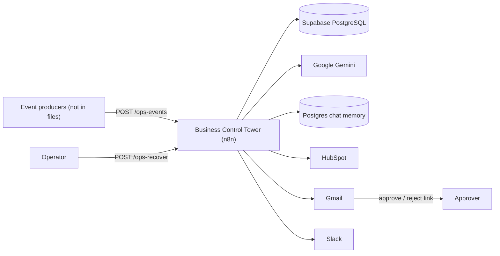
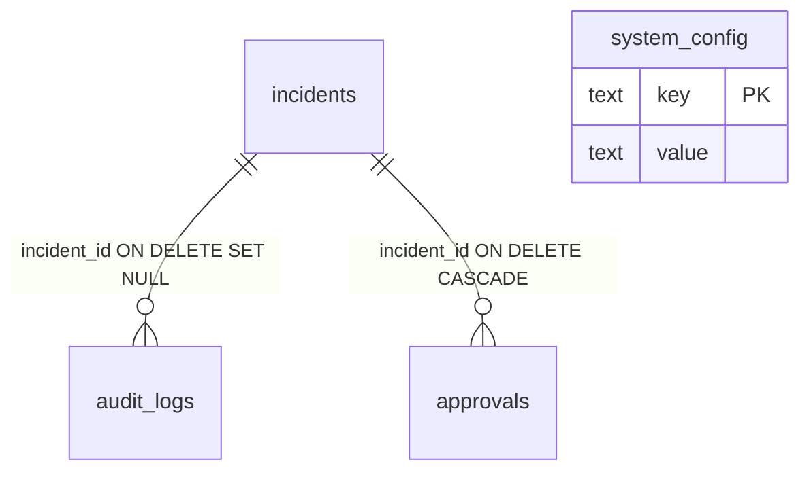
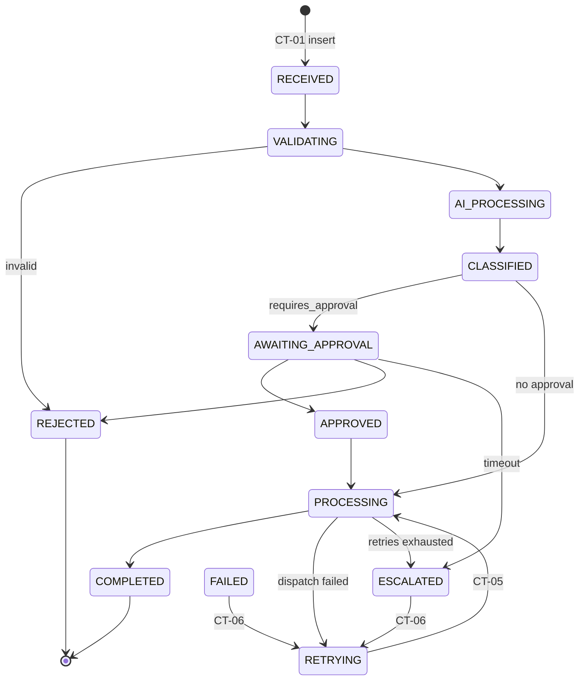
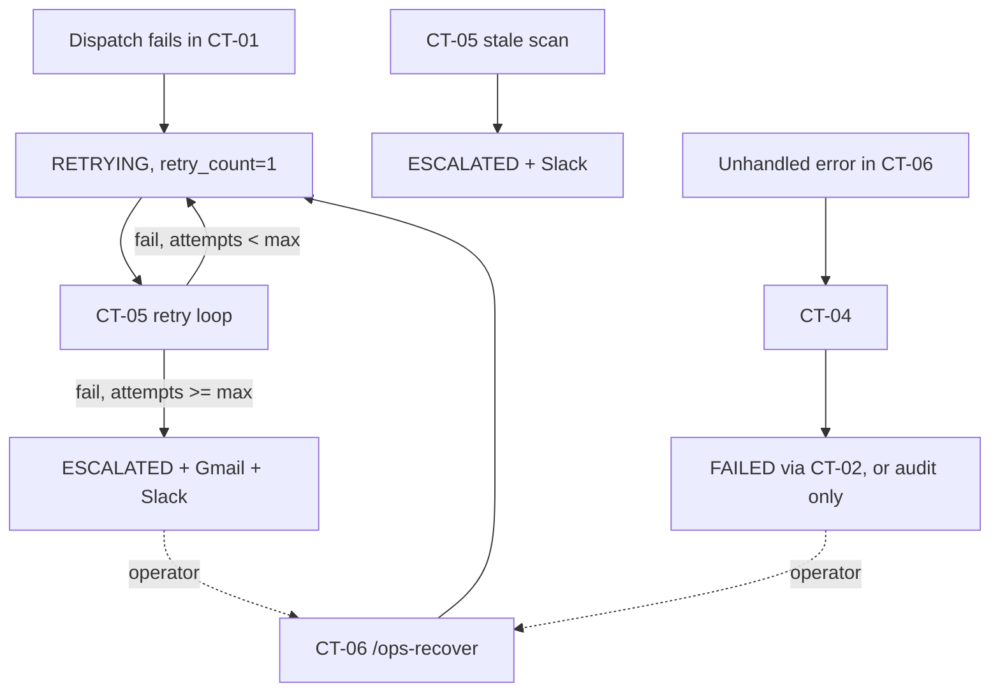

# ARCHITECTURE.md

**Evidence basis:** seven workflow exports + supplied SQL. No runtime evidence. **Convention:** solid arrow = verified in JSON; dashed arrow = disabled, proposed or unverified. Finding IDs (F-xx) refer to [ARCHITECTURE_REVIEW.md](ARCHITECTURE_REVIEW.md).

## 1. System context

*Purpose:* show the system boundary and who/what it talks to. *Proves:* the external parties named in node configuration.

The identity of event producers is **UNVERIFIED**; the files only define the webhook.

## 2. Logical component architecture

| Layer | Component | Evidence |
|---|---|---|
| Ingress | CT-01 webhook, CT-06 webhook, CT-05 schedule, CT-04 error trigger | trigger nodes |
| Orchestration | CT-01 (pipeline), CT-05 (recovery loop) | node graphs |
| State service | CT-02 (validation of transitions + writes) | Code - Validate Transition |
| Action service | CT-03 (Slack) | Slack node |
| Reliability | CT-04, CT-05, CT-06 | |
| Integration (optional) | CT-07 (HubSpot) | disabled caller |
| Persistence | Supabase tables | Supabase nodes |
| Intelligence | Gemini agent + deterministic scoring code | agent + Code node |

Design principle stated in the files and confirmed in code: **the AI assesses, code decides** approval, priority, risk and SLA.

## 3. Seven-workflow interaction architecture

*Proves:* which workflow invokes which. See Diagram B in [architecture-diagram.md](architecture-diagram.md).

| Caller | Callee | Node | Wait? |
|---|---|---|---|
| CT-01 | CT-02 | 11 Execute Workflow nodes | yes |
| CT-01 | CT-03 | `Sub-workflow - Dispatch Action (CT-03)` (error output enabled) | yes |
| CT-04 | CT-02 | `Sub-workflow - Set FAILED (CT-02)` | yes |
| CT-05 | CT-02 | 4 nodes (PROCESSING, COMPLETED, failure record, ESCALATED) | yes |
| CT-05 | CT-03 | `Sub-workflow - Re-Dispatch Action (CT-03)` (error output enabled) | yes |
| CT-06 | CT-02 | `Sub-workflow - Set RETRYING (CT-02)` | yes |
| CT-02 | CT-07 | `...(CT-07)`, `waitForSubWorkflow:false`, **disabled** | no |

Caller settings: only CT-06 declares `errorWorkflow` (CT-04) and `callerPolicy: workflowsFromSameOwner`. CT-02/03/07 declare no `callerPolicy`, so the n8n default applies (UNVERIFIED).

## 4. End-to-end data flow

Summarised in Diagram C and traced field by field in [DATA_FLOW.md](DATA_FLOW.md). Key fact: **data does not persist between executions**; handoffs happen through (a) sub-workflow input/output, and (b) the `incidents` row (CT-05 and CT-06 re-read it).

## 5. External API integration architecture

| Service | Via | Workflows |
|---|---|---|
| Supabase | native Supabase node (REST/PostgREST) | all except CT-04's Slack branch |
| Google Gemini | LangChain chat model node | CT-01 |
| Postgres (chat memory) | LangChain memory node, direct Postgres credential | CT-01 |
| Slack | native Slack node (post to channel) | CT-01, CT-03, CT-04, CT-05 |
| Gmail | native Gmail node (`sendAndWait`, `send`) | CT-01, CT-05 |
| HubSpot | native node (search) and HTTP Request (`POST /crm/v3/objects/notes`) | CT-01, CT-07 |

Details: [API_AND_INTEGRATIONS.md](API_AND_INTEGRATIONS.md).

## 6. Supabase database architecture

Writers: CT-01 (insert/update incidents, insert/update approvals), CT-02 (update incidents, insert audit_logs), CT-04/05/07 (insert audit_logs). Readers: CT-01, CT-04, CT-05, CT-06, CT-07 (incidents), CT-03 (system_config). `approvals` is never read. See [DATABASE_SCHEMA.md](DATABASE_SCHEMA.md).

## 7. Incident state-transition architecture

Any open state may also go to ESCALATED (CT-05 stale scan) or FAILED (CT-04); omitted for readability. The full verified table is in [DATABASE_SCHEMA.md](DATABASE_SCHEMA.md#state-transitions).

## 8. Failure handling and recovery architecture

Retry mechanisms, kept distinct:

| Type | Where | Parameters |
|---|---|---|
| n8n node retry | Slack in CT-03; HubSpot lookup in CT-01 and CT-07; AI Agent in CT-01 | 3 tries/2 s; 3 tries/2 s; 2 tries/1.5 s |
| Explicit loop | CT-05 Branch A | one dispatch per tick per due incident |
| DB counters | `retry_count`, `max_retries`, `next_retry_at` | CT-05 reads `max_retries` (default 3 if falsy); n8n does not |
| Scheduled | CT-05 | linear backoff: `attempts x 1 min` (demo constant) |
| Manual replay | CT-06 | resets `retry_count` to 0 |
| Exhaustion | CT-05 | ESCALATED, Gmail + Slack |

Gaps: CT-04 is not an error workflow of CT-01/CT-05 in the export (F-04); CT-04 cannot match CT-05/CT-06 executions to incidents (F-06); recovery skips approval (F-02).

## 9. Human approval and notification architecture

Approval (CT-01): `requires_approval` = severity HIGH/CRITICAL, or risk >= 75, or AI failed, or confidence < 0.60. An `approvals` row is inserted `PENDING`; Gmail `sendAndWait` (double approval: approve/Reject) waits 45 min; `Code - Read Approval Decision` maps `data.approved` true/false/undefined to APPROVED/REJECTED/TIMEOUT; the approval row is updated; CT-02 sets state; a Switch routes. A failed Gmail send is indistinguishable from a timeout (F-12). Approver identity is a placeholder (F-10).

Notifications: Slack channel `C0BTY146ACF` is hard-coded in CT-01, CT-04, CT-05; CT-03 uses `system_config.dispatch_channel_id`. `escalation_channel_id` is unused.
