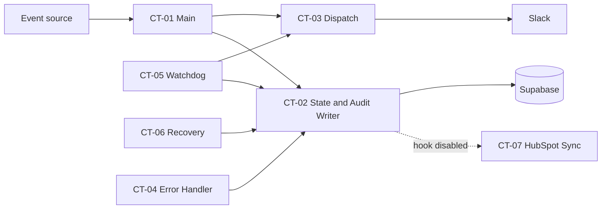

# Business Control Tower

An n8n + Supabase automation platform that receives business events, validates and signs them, asks an AI agent (**Brainpower**) to assess impact, scores and routes them with deterministic code, optionally requests human approval by email, dispatches a Slack alert, retries failures on a schedule, and records every state change in an audit log.

> **Evidence basis.** This documentation was reverse-engineered from seven exported n8n workflow JSON files and one SQL schema. **No execution logs, live database access, or runtime test results were supplied.** Nothing here claims a workflow has been run or that an integration works at runtime. Status labels: `IMPLEMENTED` (present in the JSON), `PARTIALLY IMPLEMENTED`, `CONFIGURATION REQUIRED`, `NOT IMPLEMENTED`, `UNVERIFIED`.

## 1. Business problem and objectives

Operational teams (Sales, Logistics, Finance, Customer Service, Inventory, Procurement) generate events such as shipment delays. Without a control layer, events are handled ad hoc, high-risk ones are not approved, failed notifications are lost, and nobody can prove what happened.

Objectives (as implemented): one intake endpoint, schema validation, duplicate rejection, AI impact assessment with a safe fallback, deterministic priority/risk/SLA, human approval gate, Slack dispatch, scheduled retries with escalation, a global error handler, a human recovery endpoint, and a full audit trail.

## 2. Verified capabilities

| Capability | Where | Status |
|---|---|---|
| Webhook intake `POST /ops-events`, 200/202/400 responses | CT-01 | IMPLEMENTED (no authentication configured, see F-03) |
| Validation + normalisation + SHA-256 payload hash | CT-01 | IMPLEMENTED |
| Duplicate detection by `event_id` | CT-01 + DB `UNIQUE` | IMPLEMENTED (check-then-insert, race possible) |
| AI assessment (Gemini via n8n AI Agent, Postgres chat memory, structured parser) | CT-01 | IMPLEMENTED, CONFIGURATION REQUIRED |
| Safe AI fallback + audit | CT-01 | IMPLEMENTED |
| Deterministic risk score, priority, SLA, approval rule | CT-01 | IMPLEMENTED |
| Gmail approve/reject with 45-minute wait | CT-01 | IMPLEMENTED, CONFIGURATION REQUIRED |
| Slack dispatch with simulated-failure switch | CT-03 | IMPLEMENTED |
| Single state/audit writer with transition validation | CT-02 | IMPLEMENTED (caller-trusted, see F-05) |
| Global error handler (Slack + FAILED/audit) | CT-04 | IMPLEMENTED; attached only to CT-06 in the export (F-04) |
| Watchdog: retries, stale scan, systemic-failure alert | CT-05 | IMPLEMENTED |
| Human recovery `POST /ops-recover` | CT-06 | IMPLEMENTED (no authentication, F-01) |
| HubSpot outcome note | CT-07 | IMPLEMENTED but **never triggered**: the CT-02 hook node is disabled (F-07) |

## 3. Architecture at a glance

See [`architecture-diagram.md`](architecture-diagram.md) (three diagrams) and [`ARCHITECTURE.md`](ARCHITECTURE.md).

Solid arrows are verified in the JSON; dashed arrows are present but disabled/unverified.

## 4. Workflow inventory

| Workflow | Business Responsibility | Trigger | Inputs | Outputs | Dependencies | Implementation Status |
|---|---|---|---|---|---|---|
| **CT-01 Main - Event Intake & Orchestration** (`wdj1MhTpYhbnDcvZ`) | Intake, validate, dedupe, AI assess, score, approve, dispatch | Webhook `POST /ops-events` | Event JSON | HTTP 200/202/400; incident row; state changes | CT-02, CT-03; Supabase, Gemini, Postgres memory, HubSpot (read), Gmail, Slack | IMPLEMENTED, CONFIG REQUIRED |
| **CT-02 Sub - State & Audit Writer** (`7krMfRZepEVi3L9V`) | Sole writer of `incidents.state`; appends audit row | Execute Workflow Trigger | `{incident_id, previous_state, new_state, patch, ...}` | `{ok, incident_id, new_state, context}` | Supabase; CT-07 (disabled) | IMPLEMENTED (hook disabled) |
| **CT-03 Sub - Dispatch Action** (`JfhHBm4rMmgkcByL`) | Post incident alert to Slack | Execute Workflow Trigger | `{incident, attempt}` | `{ok:true, incident}` or workflow failure | Supabase `system_config`, Slack | IMPLEMENTED, CONFIG REQUIRED |
| **CT-04 Global Error Handler** (`maC3TWvbbZsLZAuZ`) | Alert on workflow errors; mark incident FAILED or log only | Error Trigger | n8n error object | Slack alert; FAILED state or audit row | Slack, Supabase, CT-02 | IMPLEMENTED; wiring PARTIAL |
| **CT-05 Watchdog** (`r0fuIsVxDFgJv6lO`) | Retry loop, stale scan, systemic detection | Schedule (interval to confirm) | DB rows | State changes, Gmail, Slack, audit rows | Supabase, CT-02, CT-03, Gmail, Slack | IMPLEMENTED, CONFIG REQUIRED |
| **CT-06 Human Recovery Endpoint** (`tD6epzMZZTjPTWuy`) | Move ESCALATED/FAILED incident to RETRYING | Webhook `POST /ops-recover` | `{incident_no, actor?, note?}` | HTTP 200/409 | Supabase, CT-02 | IMPLEMENTED (unauthenticated) |
| **CT-07 Sub - HubSpot Outcome Sync** (`Vv0K3JHniLnTpKqV`) | Add outcome note to HubSpot contact | Execute Workflow Trigger | `{incident_id}` | HubSpot note; audit row | Supabase, HubSpot | IMPLEMENTED; not invoked |

## 5. How the workflows interact

All links below are Execute Sub-workflow nodes in the JSON. No workflow calls another by webhook; CT-01 and CT-06 are the only HTTP entry points.

- CT-01 -> CT-02 (11 call sites), CT-01 -> CT-03.
- CT-05 -> CT-02, CT-05 -> CT-03.
- CT-06 -> CT-02. CT-04 -> CT-02.
- CT-02 -> CT-07 (node `disabled: true`).
- CT-04 is referenced as `errorWorkflow` only in CT-06's settings.
- Database-driven handoff: CT-01 leaves incidents in `RETRYING`; CT-05 finds them by polling. CT-06 does the same.

## 6. Technology stack

Verified in JSON: n8n (workflow engine, AI Agent nodes), Supabase PostgreSQL via the native Supabase node, Google Gemini chat model, n8n Postgres Chat Memory (direct Postgres credential), Slack node, Gmail node (Send and Wait; send), HubSpot native node (search) and HTTP Request (notes). Planned/not present: RLS policies, dashboards, authentication on webhooks, per-department notification routing.

## 7. Setup summary

Full steps in [`SETUP_AND_OPERATIONS.md`](SETUP_AND_OPERATIONS.md). In short: run the schema in Supabase (note it **drops existing tables**), create credentials (Supabase, Gemini, Postgres, Slack, Gmail, HubSpot), import workflows **CT-02, CT-03, CT-07 first**, re-select the sub-workflow targets in every Execute Workflow node, set `dispatch_channel_id`, set CT-04 as Error Workflow on CT-01/CT-05/CT-06, then activate. Never commit credentials; `.env.example` should hold placeholders only.

## 8. Documentation index

| Document | Purpose |
|---|---|
| [ARCHITECTURE.md](ARCHITECTURE.md) | Nine architecture views |
| [architecture-diagram.md](architecture-diagram.md) | Three presentation diagrams |
| [API_AND_INTEGRATIONS.md](API_AND_INTEGRATIONS.md) | Every integration |
| [DATABASE_SCHEMA.md](DATABASE_SCHEMA.md) | Schema, states, RLS review |
| [DATA_FLOW.md](DATA_FLOW.md) | Traced example `EVT-DEMO-1001` |
| [TESTING_AND_QA.md](TESTING_AND_QA.md) | Test plan and SQL |
| [SETUP_AND_OPERATIONS.md](SETUP_AND_OPERATIONS.md) | Deployment and operations |
| [PROJECT_STRUCTURE.md](PROJECT_STRUCTURE.md) | Repo layout |
| [ARCHITECTURE_REVIEW.md](ARCHITECTURE_REVIEW.md) | Findings, risks, checklist |
| [docs/workflow-readmes/](docs/workflow-readmes/) | CT-01 to CT-07 READMEs |

## 9. Known limitations (headline)

Unauthenticated webhooks (F-01, F-03); recovery can bypass approval (F-02); CT-04 not attached to CT-01/CT-05 in the export (F-04); no concurrency guard on state writes (F-05); HubSpot sync disabled (F-07); "COMPLETED" means only that a Slack message was posted (F-17); RLS enabled with no policies (F-15). Details in [ARCHITECTURE_REVIEW.md](ARCHITECTURE_REVIEW.md).

## 10. Troubleshooting (quick)

| Symptom | Likely cause (from the JSON) |
|---|---|
| All dispatches fail with "dispatch_channel_id is missing" | Seed value still `C_REPLACE_ME`, or Supabase filter semantics (F-13) |
| Duplicate response for a corrected resubmission | The rejected incident still owns the `event_id` (F-11) |
| Incident stuck in a state | CT-05 escalates after 10 min (60 for AWAITING_APPROVAL) if CT-05 is active |
| No Slack/HubSpot note on completion | CT-07 hook disabled (F-07) |
| Empty reads from Supabase | Anon key used with RLS and no policies (F-15) |
