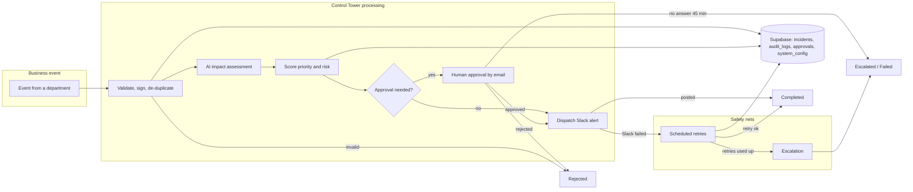
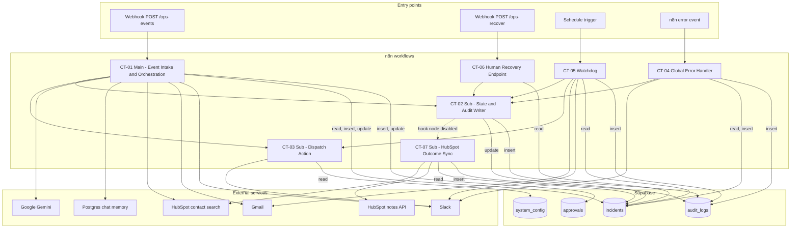
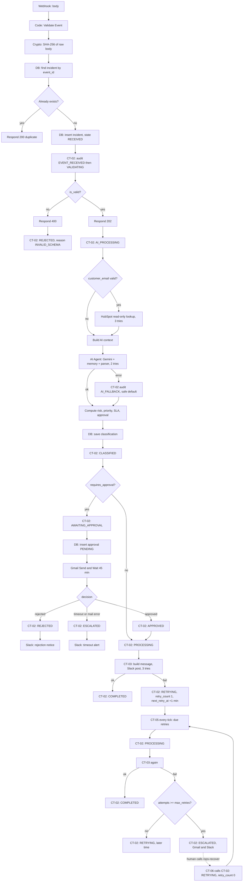

# Business Control Tower: Architecture Diagrams

Convention: **solid arrows** = relationship verified in the workflow JSON. **Dashed arrows** = present but disabled, or proposed/unverified. All diagrams reflect the exports only; no runtime execution evidence exists.

## Diagram A: Executive Overview

**Explanation.** An event enters, is checked, scored and either dispatched straight to Slack or held for a human decision. If Slack fails, a scheduler retries; if retries run out, the incident is escalated. Everything is stored in Supabase. "Completed" means the Slack message was posted; the files contain no further business action.

## Diagram B: Seven-Workflow System Blueprint

**Explanation.** CT-02 is the hub: every state change from CT-01, CT-04, CT-05 and CT-06 passes through it. CT-03 is the only place that posts incident alerts; CT-01 calls it once, CT-05 calls it for retries. CT-04 is wired as error workflow only on CT-06 in the export (not drawn, because it is a setting, not a node connection). `escalation_channel_id` in `system_config` is read by no workflow.

## Diagram C: Detailed Data and Decision Flow

**Explanation.** The diagram follows one event from webhook to a terminal state, using only nodes present in CT-01, CT-03 and CT-05. The dashed arrow is the human recovery loop (CT-06): it is a separate workflow reached by an operator, not an automatic step. Not shown: stale scan, systemic alert and global error handling (see ARCHITECTURE.md section 8).
